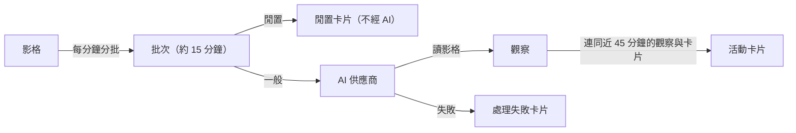

# 範圍

本機制負責把錄製保存的影格變成時間軸上的「活動卡片」：如何把影格分成批次、何時送給 AI、閒置時段如何不經 AI 直接產生卡片、主要與備援 AI 供應商如何接手、新卡片如何取代舊卡片，以及失敗時的卡片、提示與自動補做。卡片在時間軸上如何呈現與編輯，由時間軸領域負責。

引用本機制的功能：

| 功能 | 操作意圖 |
|---|---|
| [⚙定時分析新的錄製](<[功能]⚙定時分析新的錄製.md>) | 每分鐘把新的影格分批送去分析 |
| [重試失敗的時段](<[功能]重試失敗的時段.md>) | 使用者在時間軸上重試某一天失敗的時段 |
| [重新處理某一天](<[功能]重新處理某一天.md>) | 使用者在設定中讓某一天整天重新分析 |
| [設定 AI 供應商](<[功能]設定AI供應商.md>) | 選擇主要與備援 AI 供應商 |

# Big Picture

## 參與對象

| 對象 | 意思 |
|---|---|
| 影格 | 錄製保存的一張畫面，帶擷取時間與擷取當下的閒置秒數 |
| 批次 | 一段連續影格（目標 15 分鐘）組成的分析單位；每張影格只屬於一個批次 |
| 觀察 | AI 讀影格後寫下的逐段文字描述（某段時間畫面上在做什麼） |
| 活動卡片 | 時間軸上的一張卡：起訖時間、標題、摘要、詳細說明、分類、子分類、分心片段、主要使用的 App／網站 |
| AI 供應商 | 負責讀影格與寫卡片的 AI；使用者設定一個主要供應商，可另設一個備援 |

## 批次的狀態

| 狀態 | 意思 |
|---|---|
| pending | 已建立，尚未送去分析 |
| processing | 正在分析（App 中途結束時會殘留此狀態） |
| analyzed | 分析成功（含閒置卡片、AI 沒有讀出任何觀察的情況） |
| completed | 分析成功並完成後續處理 |
| failed | 分析失敗，時間軸上有「處理失敗」卡片 |
| failed_empty | 批次裡沒有可用的影格 |
| skipped_short | 批次頭尾不到 5 分鐘，不分析 |

## 不能互相推定的事

| 已發生的事 | 不能據此推定 |
|---|---|
| 批次狀態是 processing | AI 正在處理它：App 中途結束會留下這個狀態，系統另外記錄真正處理中的批次 |
| 批次失敗 | 錄製遺失：失敗卡片上註明錄製仍保存，之後可以重試 |
| 卡片標成備援產生 | 主要供應商已經壞掉不能用：只代表這一批有某一步改由備援完成 |

# 分批

1. 每分鐘一次，取過去 24 小時內尚未屬於任何批次、且未被刪除的影格，依擷取時間排序。
2. 依序放進同一批次，直到下一張與前一張相隔超過 2 分鐘，或下一張距離批次第一張超過 15 分鐘，就關閉這一批、從下一張開新批次。
3. 最後一批若頭尾不到 15 分鐘，視為還在累積，這一輪不建立，等下一輪。
4. 建立的批次狀態為 pending，接著逐一送去分析。
5. 送去分析前的檢查：
    1. 批次裡沒有影格 → failed_empty，不產生卡片。
    2. 第一張到最後一張不到 5 分鐘 → skipped_short，不產生卡片。

# 閒置判定

送給 AI 之前先判斷這一批是不是整段閒置；是的話直接寫一張「Idle」卡片，不呼叫 AI。

1. 判定條件（全部成立才算閒置）：
    1. 批次頭尾至少 12 分鐘。
    2. 每張影格的「擷取當下已閒置秒數」往回推，可以覆蓋批次時間的至少 95%，且沒有覆蓋到的空檔最長不超過 30 秒。
    3. 至少 90% 的影格記錄了閒置秒數。
    4. 至少 90% 的影格擷取當下已閒置 60 秒以上。
2. 閒置卡片的分類與標題都是「Idle」，摘要為「You were idle during this period.」，時間以整分鐘計：結束時間是最後一張影格的時間（捨去秒數）。
3. 合併：前一張卡片（在這批開始前結束、不屬於這一批）也是 Idle、在同一天，且與這批開始相距不到 5 分鐘時，延長那張卡片到這批的結束時間，不另建新卡片。
4. 不合併時，新卡片從「這批第一張影格的整分鐘」與「前一張卡片的結束時間」兩者較晚者開始，讓前一張一般卡片保有共用的那一分鐘。
5. 結束時間不晚於開始時間，或寫入失敗時，改走一般的 AI 分析。
6. 成功時批次狀態為 analyzed；只移除這一批自己先前的卡片，不動其他批次的卡片。

# AI 供應商

使用者可選的供應商：

| 供應商 | 需要的設定 | 一次完成讀影格與寫卡片 |
|---|---|---|
| Dayflow（Dayflow Pro） | 已登入且 Pro 方案有效 | 是 |
| Gemini | Gemini API key | 否；Gemini 失敗時同一批改用同一把 key 的 Gemma 模型接手 |
| ChatGPT | 本機安裝 Codex 命令列工具並完成設定 | 是 |
| Claude | 本機安裝 Claude Code 命令列工具並完成設定 | 是 |
| OpenAI 相容服務 | 服務網址、模型，以及 API key（自訂服務可不填 key） | 否 |
| 本機模型（Ollama／LM Studio） | 服務網址與模型 | 否 |

1. 每一批依當下保存的設定決定主要供應商；設定讀取失敗時這一批直接失敗。
2. 備援供應商與主要供應商不能相同；未設定或無法啟用時沒有備援。
3. 主要供應商無法啟用（例如設定不完整）而備援可以時，這一批全程改用備援。

# 一批的分析流程

## Workflow

1. 批次狀態設為 processing。
2. Decision: 這一批的影格是否全是閒置
    1. Branch: 是，且閒置卡片寫入成功
        1. Return: 依「閒置判定」完成。
    2. Else:
        1. 不執行額外動作。
3. 決定主要與備援供應商；兩者都無法啟用時，依「失敗的處理」結束。
4. Decision: 主要供應商能否一次完成讀影格與寫卡片
    1. Branch: 能
        1. 等待取得「時間軸改寫權」（同一時間只有一批能改寫時間軸）。
        2. 把影格與近 45 分鐘的既有卡片、分類清單交給主要供應商，一次取得觀察與卡片，保存觀察。
        3. Decision: 這一步是否成功
            1. Branch: 成功
                1. 不執行額外動作。
            2. Branch: Dayflow 拒絕（未登入、方案未付費或無權限）
                1. Return: 依「失敗的處理」結束，不再改走兩段式。
            3. Else:
                1. 改走下面的兩段式。
    2. Else:
        1. 不執行額外動作。
5. Decision: 是否已取得卡片
    1. Branch: 尚未取得
        1. 讀影格寫觀察：交給主要供應商；失敗時交給備援。觀察保存到這一批。
        2. Decision: 是否讀出任何觀察
            1. Branch: 沒有
                1. 批次狀態設為 analyzed，不產生卡片。
                2. Return: 成功，沒有卡片。
            2. Else:
                1. 不執行額外動作。
        3. 等待取得時間軸改寫權。
        4. 寫卡片：把近 45 分鐘內的所有觀察、既有卡片（排除系統卡片）、分類清單交給目前的供應商；失敗時交給備援。
    2. Else:
        1. 不執行額外動作。
6. 依「新卡片取代舊卡片」寫入卡片；任何一步由備援（含 Gemma）完成時，卡片標記為備援產生。
7. 批次狀態設為 analyzed，隱藏畫面上的失敗提示，釋放時間軸改寫權。

## 新卡片取代舊卡片

1. AI 寫卡片時會重新整理近 45 分鐘的時間軸，所以新卡片取代一段時間範圍內的舊卡片：
    1. 看過整個 45 分鐘範圍的供應商：取代「批次結束前 45 分鐘」到「批次結束」之間的卡片。
    2. 只看過與這一批相連卡片的供應商（Claude）：只取代它回報改寫的那段時間，而且不刪除在這一批開始之後才開始、屬於較新批次的卡片。
2. 被取代的卡片若有縮時影片，影片檔一併刪除。
3. 卡片的「一天」依開始時間以早上 4:00 為界決定。

# 失敗的處理

1. 任何一步失敗（含備援也失敗）時：
    1. 批次狀態設為 failed，原始錯誤記在批次上供除錯，使用者看不到。
    2. 依錯誤內容歸類（見下表），把這一批的時間範圍內的卡片換成一張「處理失敗」卡片：分類 System、子分類 Error、標題「Processing failed」，摘要是該類別的白話說明加上「Your recording is saved.」。較新批次在這段時間之後開始的卡片保留。
    3. 若屬於「使用者必須自己處理」的類別，在畫面右下角顯示提示卡（同一類別每天最多一次），說明原因、步驟（必要時附可複製的終端機指令）與前往設定或帳號的按鈕，並顯示過去 24 小時有多少錄製時間在等待重試。
2. 錯誤類別：

| 類別 | 使用者是否需要處理 | 例子 |
|---|---|---|
| Dayflow Pro 已到期 | 是（前往帳號） | dayflow pro is required |
| 供應商登入過期 | 是 | not logged in、run /login |
| 找不到命令列工具 | 是 | cli not found |
| Codex 版本過舊 | 是 | requires a newer version of codex |
| 本機模型服務未開啟 | 是 | Ollama／LM Studio 連不到 |
| 本機模型未載入 | 是 | no models loaded |
| API key 有問題 | 是 | invalid api key |
| 用量已達上限 | 是 | usage limit |
| 額度用完 | 是 | out of credits |
| 所在地區不支援 | 是 | location is not supported |
| 帳號被封鎖 | 是 | denied access |
| 選用的模型不可用 | 是 | not_found_error |
| 尚未設定供應商 | 是 | no llm provider configured |
| 暫時性問題 | 否，自動重試 | timed out、503、too many requests |
| AI 回覆格式錯亂 | 否，自動重試 | failed to parse、卡片時間不連續 |
| 其他 | 否，自動重試 | — |

3. 失敗卡片只在這一批仍有可用影格時顯示在時間軸上，也才能重試；影格已被清除的失敗卡片不顯示。

# 自動補做失敗的批次

1. 任何一批分析成功後，代表供應商又能用了，系統依序自動重試過去 24 小時內的失敗批次（最舊的先），一次一批。
2. 納入條件：批次狀態為 failed，或殘留 processing 但目前不在處理中；時間軸上仍顯示它的失敗卡片（且有可用影格）；這次 App 執行中自動重試未滿 3 次。
3. 重試前再確認一次條件，因為較新批次的卡片可能已經蓋掉它的失敗卡片。
4. 任一批重試失敗就停止，其餘等下一次有批次成功時再補。
5. 使用者正在手動重試時不自動補做；自動補做進行中不會重複啟動。

# 實例化情境

小晴用 Claude 當主要供應商、Gemini 當備援。

| 時間 | 發生什麼 | 結果 |
|---|---|---|
| 09:00–09:15 | 一般工作，錄了 90 張影格 | 09:16 分批，Claude 一次讀完並寫卡片「修 OAuth 登入」 |
| 09:15–09:30 | Claude 登入過期 | 一次完成失敗，改兩段式：Claude 讀影格失敗 → Gemini 讀影格成功；寫卡片 Claude 失敗 → Gemini 成功；卡片標記備援產生 |
| 12:00–12:15 | 去吃午餐，影格的閒置秒數一路累積 | 判定閒置，直接寫 Idle 卡片，不呼叫 AI |
| 12:15–12:30 | 仍在午餐 | 與前一張 Idle 卡片相隔不到 5 分鐘，延長那張卡片 |
| 14:00–14:15 | 網路中斷，Claude 與 Gemini 都失敗 | 換成「處理失敗」卡片（暫時性問題，不跳提示） |
| 14:30 | 下一批成功 | 自動重試 14:00 那一批，成功後失敗卡片被新卡片取代 |
